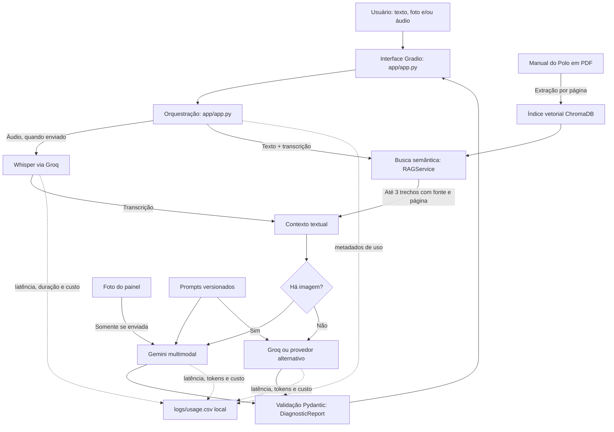

# Arquitetura e dados

## Arquitetura e fluxo de uma requisição

O fluxo não mantém memória conversacional entre solicitações. O cache de respostas existe apenas durante a execução do processo. O índice ChromaDB é criado em memória e alimentado com o manual local na primeira busca; não há banco persistente de conversas. Com áudio, a gravação é enviada ao endpoint de transcrição Groq; o texto, a transcrição e os trechos recuperados do manual seguem no contexto do modelo de diagnóstico. Se houver imagem, ela é enviada ao Gemini para análise visual. Consultas sem imagem usam o provedor configurado e o fallback implementado.

## Dados utilizados

| Dado | Origem e quantidade conhecida | Uso |
| --- | --- | --- |
| Manual técnico | 1 PDF oficial Volkswagen Brasil, **Manual de instruções — Polo**, edição/identificação `V2, R2, Brazil, pt_BR`, fechamento 18/12/2024, edição impressa 03/2025, código `2GB012766BO`; 270 páginas (todas atendem ao filtro atual de extração). Arquivo local: `manuals/26A_5B1_POL_66_Manual_de_instrucoes.pdf`. | Fonte do RAG; o texto é extraído por página e indexado no ChromaDB. |
| Casos de avaliação RAG | 10 perguntas e páginas de referência em `dados/exemplos/perguntas_rag.json`. | Medir recuperação de páginas esperadas; a linha de base registrada é 8/10 (80%) em acerto@3. |
| Entradas sintéticas de demonstração | 1 imagem gerada artificialmente em `dados/exemplos/painel_sintetico.png` e 1 áudio sintetizado localmente em `dados/exemplos/relato_sintetico.wav`. Não representam veículo nem pessoa real. | Testar imagem e transcrição sem dados pessoais; não compõem um dataset real de usuário. |

Evidências da execução na interface estão em `docs/evidencias_caso_sintetico.png` e `docs/evidencias_erro_gemini.png`. O caso de erro foi executado com Gemini desabilitado e RAG substituído por contexto de teste, sem chamada externa.

Fonte oficial do manual: [Volkswagen Brasil — Manual de instruções do Novo Polo (PDF)](https://www.vw.com.br/idhub/content/dam/onehub_pkw/importers/br/literatura-de-bordo/manual-novo-polo/my26/26A_5B1_POL_66_Manual_de_instrucoes.pdf). Os dados de edição e a contagem foram verificados no PDF presente no repositório.

## Privacidade e direitos de uso

- O manual é uma publicação da Volkswagen e não contém dados pessoais de usuários do protótipo. A disponibilidade pública do PDF não significa que ele tenha licença aberta. A responsável pelo projeto confirmou ter autorização para manter e versionar o arquivo no repositório; cite a fonte e respeite os limites dessa autorização. Não remova avisos de direitos autorais nem presuma uma licença aberta para outros usos.
- O protótipo não persiste as conversas, mas processa as entradas em memória e as envia a serviços externos: áudio ao Groq para transcrição; imagem ao Gemini quando fornecida; texto, transcrição e trechos recuperados são enviados ao provedor LLM escolhido. Consulte os termos e as configurações de retenção dos provedores antes de usar dados reais.
- O arquivo `logs/usage.csv` guarda identificador aleatório da solicitação, modalidade, modelo/provedor, tokens ou duração, latência e custo; não deve conter texto, transcrição, imagem ou chave. O arquivo fica local e é excluído do Git.
- Para demonstrações e avaliação, use imagens sem rostos/placas identificáveis, texto sintético e áudio sem nomes ou outras informações pessoais. Não use documentos sigilosos.

## Estratégia de contexto

O problema requer consultar instruções específicas do veículo; por isso, o protótipo usa RAG sobre o manual em vez de depender apenas do conhecimento paramétrico do modelo. Cada página extraída é um documento independente no índice semântico. Essa granularidade mantém a referência de página para a resposta e reduz o risco de misturar seções distantes; a busca retorna até três páginas para compor o contexto.

A linha de base mediu **8/10 (80%) de acerto@3** nos dez casos anotados. Dois casos não recuperaram a página esperada no top 3. Experimentos de consulta expandida com RRF obtiveram 9/10 no avaliador, mas permanecem experimentais e não foram promovidos ao fluxo de produção; BM25 e janelas de páginas não superaram a linha de base. A avaliação é pequena e mede recuperação, não a correção clínica/mecânica do diagnóstico final.

## Limitações documentais a confirmar

Antes de entregar o relatório, confirme a permissão aplicável ao uso/redistribuição do manual e mantenha os termos dos provedores em consideração. Se o corpus ou os dados de demonstração mudarem, atualize as quantidades e origens acima.
